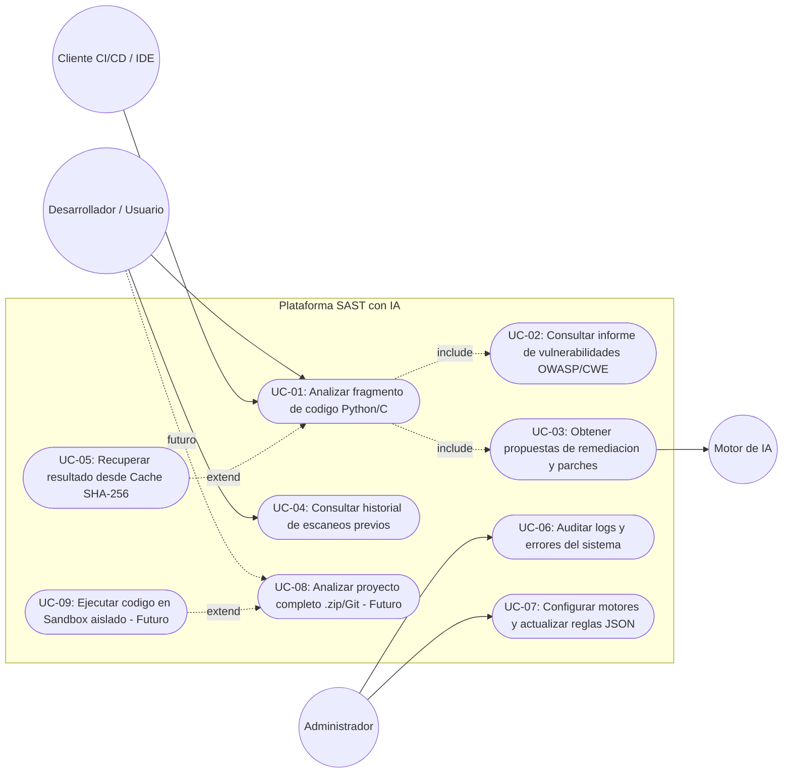

# Especificacion de Casos de Uso (Use Cases)

**Proyecto:** Analizador SAST de Ciberseguridad con IA (TFG)  
**Version:** 1.1  
**Referencia:** Basado en `Requisitos.md` y `DisenoSoftware.md`  

---

## 1. Identificacion de Actores

* **Desarrollador / Usuario Principal:** Persona que envia fragmentos de codigo fuente o proyectos para detectar vulnerabilidades, consultar clasificaciones normativas y aplicar soluciones.
* **Administrador del Sistema:** Responsable de auditar logs, configurar parametros (`.env`) y actualizar las definiciones de la base de conocimiento (`rules/`).
* **Cliente Externo (CI/CD / Web / IDE):** Sistema automatizado o interfaz grafica que consume la API REST.
* **Sistema de Cache / Base de Datos (Actor Secundario):** Componente interno encargado de verificar huellas digitales `(SHA-256, rules_version)` y persistir o recuperar historiales de escaneos.
* **Motor de Inteligencia Artificial (Actor Externo / Secundario):** Servicio o modelo LLM (local o remoto) invocado para realizar analisis semanticos profundos y generar explicaciones o parches de remediacion.

---

## 2. Diagrama General de Casos de Uso (Mermaid)

---

## 3. Especificacion Detallada de Casos de Uso

### UC-01: Analizar Fragmento de Codigo (Python / C)
* **Actor Principal:** Desarrollador / Usuario o Cliente Externo.
* **Descripcion:** El actor envia un bloque de codigo fuente (inicialmente en **Python** o **C**) a traves de la API para detectar vulnerabilidades de seguridad.
* **Precondiciones:** 
  * El servidor FastAPI esta operativo y las reglas (`rules/`) estan cargadas.
  * El payload cumple con el tamano maximo permitido y formato JSON valido.
* **Flujo Principal (Exito):**
  1. El actor envia una peticion `POST /api/v1/analyze` con el codigo fuente y el lenguaje (`python` o `c`).
  2. El sistema valida los datos de entrada mediante esquemas Pydantic.
  3. El sistema calcula el hash `SHA-256` del codigo, obtiene `rules_version` y ejecuta `UC-05` (Consultar Cache). Al no existir registro previo vigente, continua el flujo.
  4. El orquestador consulta `EngineRegistry` para obtener los motores registrados para el lenguaje (`PythonASTEngine` o `CStaticEngine`) y ejecuta el analisis sintactico/de patrones usando las definiciones de `rules/`.
  5. El sistema ejecuta `UC-02` y `UC-03` para clasificar cada hallazgo (OWASP Top 10 + CWE) y generar propuestas de remediacion mediante el motor de IA y las plantillas de reglas.
  6. El sistema guarda el informe completo en la base de datos junto con `rules_version` y registra la operacion en el log.
  7. El sistema devuelve un codigo HTTP `200 OK` con el informe JSON estructurado.
* **Flujos Alternativos y de Excepcion:**
  * **1a. Lenguaje sin motor estatico dedicado:** Si el lenguaje no tiene motor AST/estatico especifico registrado en `EngineRegistry`, el sistema registra una advertencia y delega directamente en `AIEngine`.
  * **2a. Codigo vacio o exceso de tamano (Proteccion DoS):** Pydantic rechaza la peticion y devuelve `422 Unprocessable Entity` o `413 Payload Too Large`.
  * **5a. Fallo o Timeout del Motor de IA (Tolerancia a fallos):** El sistema captura la excepcion, registra el error en `logger.py`, y devuelve los resultados obtenidos por el motor estatico marcando el estado como `partial_error`.
* **Postcondiciones:** El escaneo queda almacenado en el historico con un `scan_id` unico.

---

### UC-02 y UC-03: Clasificar Vulnerabilidades y Generar Remediacion
* **Actor Principal:** Sistema / Motor de IA (Incluidos en `UC-01`).
* **Descripcion:** Traduce los hallazgos tecnicos en un informe accionable bajo estandares internacionales.
* **Flujo Principal:**
  1. Por cada vulnerabilidad detectada (ej. `eval()` en Python o `strcpy()` en C), el sistema determina su linea exacta.
  2. Asigna el nivel de criticidad (`LOW`, `MEDIUM`, `HIGH`, `CRITICAL`).
  3. Mapea el fallo a su categoria oficial **OWASP Top 10** y codigo **CWE** (ej. `CWE-120` para Buffer Overflow).
  4. Genera una explicacion tecnica clara y un fragmento de codigo parcheado (*suggested_code*) que resuelve el fallo manteniendo la funcionalidad original.

---

### UC-04: Consultar Historial de Escaneos Previos
* **Actor Principal:** Desarrollador / Usuario.
* **Descripcion:** Permite recuperar analisis realizados en el pasado para auditoria o seguimiento de correcciones.
* **Flujo Principal:**
  1. El actor realiza una peticion `GET /api/v1/scans` (listado paginado) o `GET /api/v1/scans/{scan_id}` (detalle especifico).
  2. El repositorio consulta la base de datos.
  3. El sistema devuelve los metadatos y vulnerabilidades registradas en formato JSON (o HTTP `404 Not Found` si no existe).

---

### UC-05: Recuperar Resultado desde Cache (SHA-256)
* **Actor Principal:** Sistema (Extiende `UC-01`).
* **Descripcion:** Evita reprocesar codigo identico mientras la version de reglas siga vigente.
* **Flujo Principal:**
  1. El servicio calcula `SHA-256(language + ":" + code)` y consulta `rules_version` actual.
  2. Busca en `ScanRepository` coincidencia exacta de `(code_hash, rules_version)`.
  3. Si existe, devuelve el informe guardado inmediatamente sin invocar motores estaticos ni de IA.

---

### UC-06 y UC-07: Administracion, Auditoria y Actualizacion de Reglas
* **Actor Principal:** Administrador del Sistema.
* **Descripcion:** Permite supervisar la salud del sistema y actualizar la base de conocimiento de ataques.
* **Flujo Principal:**
  * El administrador consulta los logs centralizados (`AUDIT_LOGS` / `app.log`) para diagnosticar errores aislados (`UC-06`).
  * El administrador modifica parametros en `.env` o actualiza los ficheros JSON en `rules/` (`metadata.json`, `python_rules.json`, `c_rules.json`) para incorporar nuevas versiones de OWASP/CWE sin alterar el codigo fuente (`UC-07`).

---

### UC-08 y UC-09: Analisis de Proyectos Completos y Sandbox Docker (Fases Futuras)
* **Actor Principal:** Desarrollador / Usuario.
* **Descripcion:** Escalado previsto en la arquitectura para auditar repositorios completos (`.zip` / Git) y ejecutar codigo de forma aislada en contenedores efimeros Docker sin red ni privilegios.
