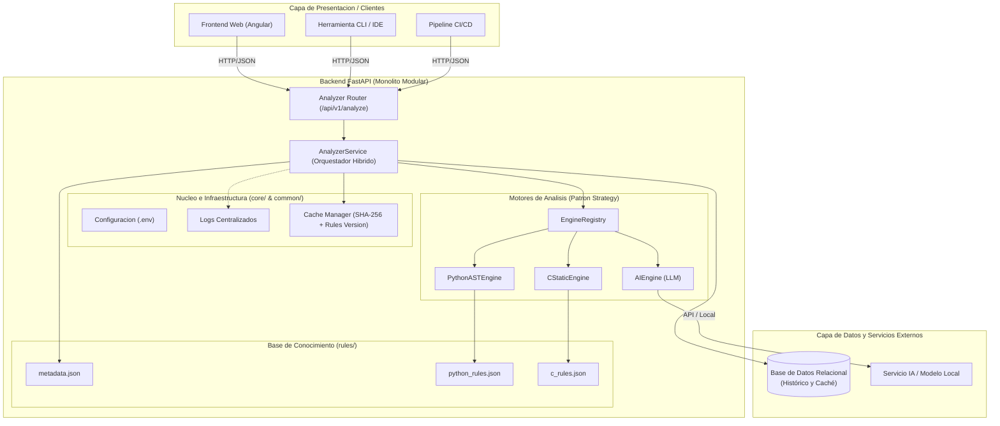
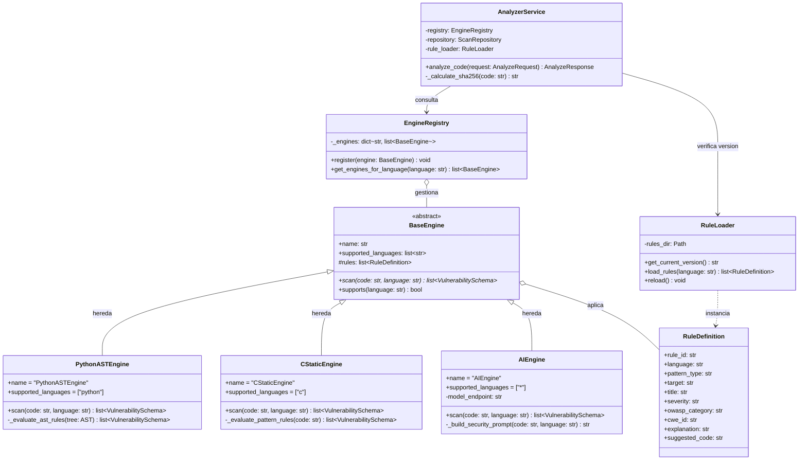
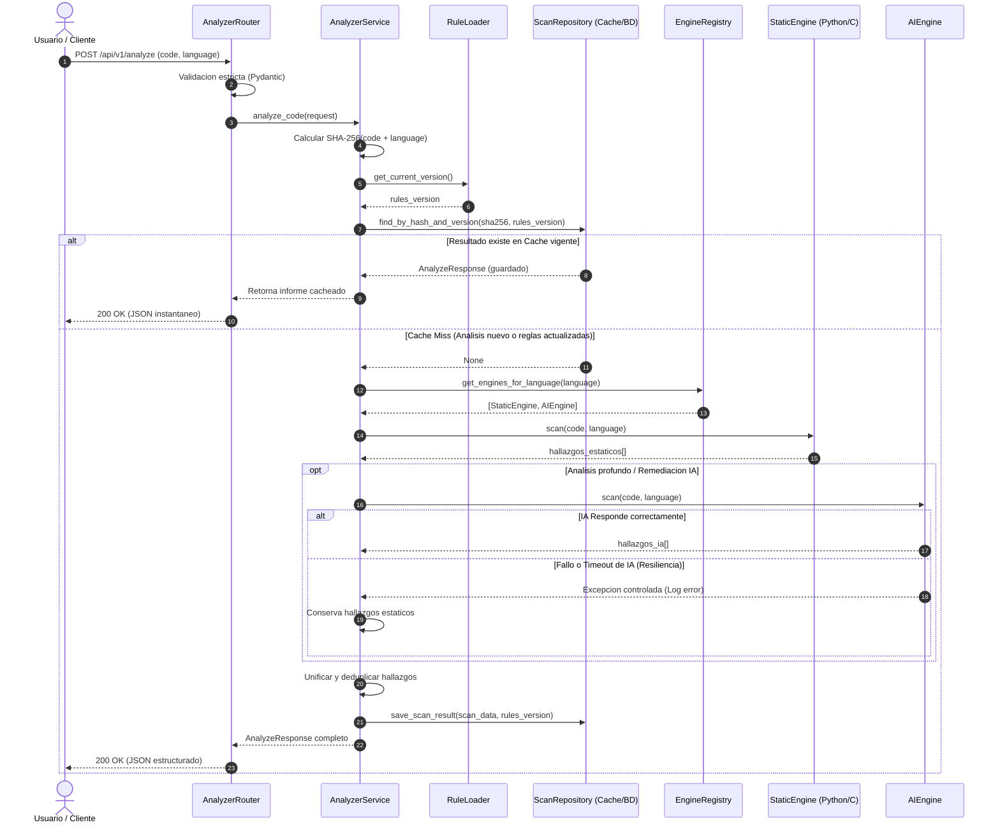

# Modelado Arquitectonico, Estructural y de Comportamiento

**Proyecto:** Analizador SAST de Ciberseguridad con IA (TFG)  
**Version:** 1.1  
**Referencia:** Estandar UML 2.5 y Modelo C4  

---

## 1. Modelado Arquitectonico (Vista de Contenedores y Componentes - C4)

El modelado arquitectonico define la macroestructura del sistema, mostrando como interactuan los clientes externos con el nucleo modular de FastAPI, la base de conocimiento desacoplada (`rules/`), los motores de analisis (`EngineRegistry`) y las capas de persistencia.

### Principios de esta Vista Arquitectonica:
* **Desacoplamiento de Clientes:** El backend expone una API REST pura, lo que permite anadir interfaces web (Angular), de consola o integraciones CI/CD sin alterar la logica del servidor.
* **Separacion de Motores y Reglas:** Los motores cargan sus definiciones desde `rules/*.json` mediante `RuleLoader`, permitiendo actualizar estandares sin modificar codigo fuente.

---

## 2. Modelado Estructural (Diagrama de Clases UML)

El modelado estructural representa la organizacion estatica del codigo: clases, interfaces abstractas, atributos, metodos y relaciones de herencia o composicion.

### Elementos Clave de la Estructura:
* **Herencia y Polimorfismo:** `PythonASTEngine`, `CStaticEngine` y `AIEngine` heredan de `BaseEngine`, garantizando que todos implementen el metodo `.scan()`.
* **Extensibilidad Multi-lenguaje:** Anadir soporte para un nuevo lenguaje (ej. Java o JavaScript) implica unicamente crear una subclase de `BaseEngine`, anadir su JSON en `rules/` y registrarla en `EngineRegistry`.

---

## 3. Modelado de Comportamiento (Diagrama de Secuencia UML)

El modelado de comportamiento describe la dinamica del sistema en tiempo de ejecucion: como colaboran los objetos paso a paso desde que llega una peticion de analisis hasta que se devuelve el informe con remediaciones.

### Garantias del Flujo de Comportamiento:
1. **Ahorro de Costes e Invalidacion Inteligente (`alt` Cache):** Si el codigo ya fue escaneado bajo la misma `rules_version`, se devuelve al instante; si las reglas se actualizaron, se re-analiza automaticamente.
2. **Tolerancia a Fallos (`alt` Resiliencia IA):** Si el motor de IA falla o excede el tiempo de espera, el flujo no se interrumpe; el sistema registra el fallo y entrega al usuario los resultados deterministas obtenidos por el motor estatico.
