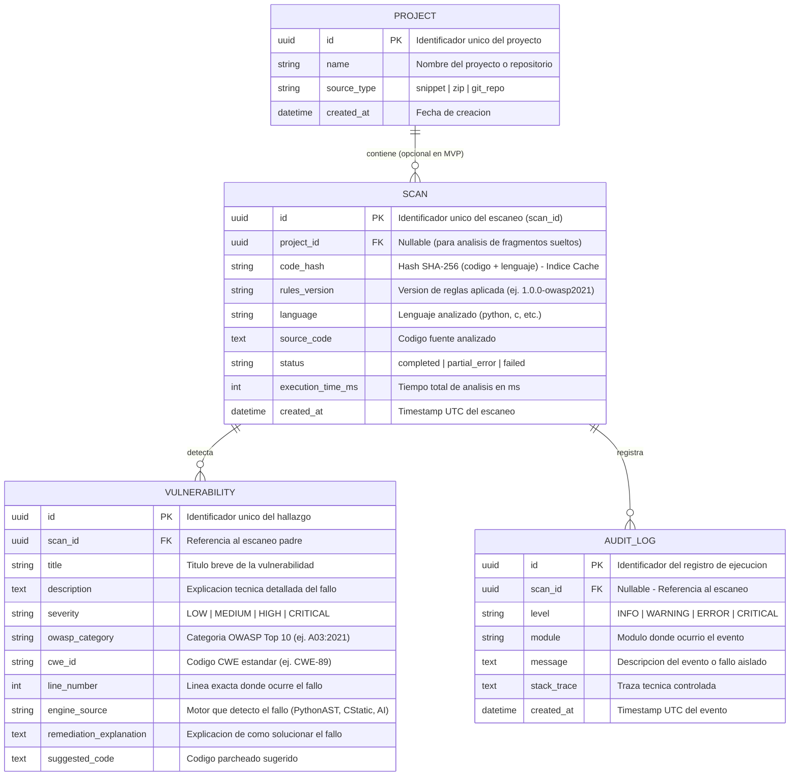

# Modelo Entidad-Relacion (E-R) y Diseno de Base de Datos

**Proyecto:** Analizador SAST de Ciberseguridad con IA (TFG)  
**Version:** 1.1  
**Tecnologia ORM:** SQLAlchemy / SQLModel (Compatible con SQLite para desarrollo y PostgreSQL para produccion)  

---

## 1. Proposito del Modelo de Datos

El diseno de la base de datos persigue tres objetivos clave definidos en los requisitos del sistema:
1. **Cache Inteligente Versionada (`RF-06`, `RNF-12`):** Evitar reprocesar fragmentos de codigo identicos mediante indexacion compuesta por huella criptografica (`SHA-256`) y version de reglas (`rules_version`), invalidando automaticamente escaneos antiguos cuando se actualiza la base de conocimiento.
2. **Trazabilidad e Historico (`RF-07`):** Mantener un registro auditable de todos los escaneos realizados, los motores ejecutados y las vulnerabilidades detectadas.
3. **Escalabilidad a Proyectos (`RF-09`):** Soportar tanto el analisis de fragmentos sueltos (MVP) como la futura agrupacion de multiples archivos dentro de un mismo proyecto o repositorio.

---

## 2. Diagrama Entidad-Relacion (Mermaid ERD)

---

## 3. Diccionario de Entidades y Relaciones

### A. Entidad `SCANS` (Nucleo de Persistencia y Cache Versionada)
* **Clave Primaria (`id`):** UUIDv4 para evitar enumeracion secuencial de escaneos en la API (`/api/v1/scans/{scan_id}`).
* **Indice Compuesto de Cache (`code_hash`, `rules_version`):** Almacena el resumen criptografico `SHA-256(language + ":" + code)` junto con la version exacta de la base de conocimiento (`rules/metadata.json`). Si el codigo ya fue escaneado bajo la version vigente de reglas, se devuelve instantaneamente; si se publicaron reglas nuevas, se re-analiza automaticamente.
* **Estado (`status`):** Refleja la tolerancia a fallos (`RNF-05`). Si el motor estatico funciono pero la IA fallo, se marca como `partial_error` en lugar de perder el escaneo.

### B. Entidad `VULNERABILITIES` (Hallazgos y Remediaciones)
* **Relacion `1:N` con `SCANS`:** Un escaneo puede contener cero (codigo limpio) o multiples vulnerabilidades.
* **Campos de Remediacion:** Separa `remediation_explanation` (por que falla y como arreglarlo) de `suggested_code` (el parche exacto), facilitando que el frontend muestre vistas comparativas (*diff*).

### C. Entidad `AUDIT_LOGS` (Auditoria y Trazabilidad de Errores)
* **Proposito:** Registrar eventos del sistema y posibles fallos aislados de cada motor (`PythonASTEngine`, `CStaticEngine`, `AIEngine`) durante un escaneo o arranque, cumpliendo con los requisitos de observabilidad y diagnostico rapido (`RNF-07`).

---

## 4. Estrategia de Evolucion (Migraciones)
* Se utilizara **Alembic** junto con SQLAlchemy/SQLModel para gestionar versiones del esquema de base de datos.
* **Entorno Local / MVP:** SQLite (`sast_tfg.db`) para cero configuracion y portabilidad inmediata.
* **Entorno Produccion / Escalado:** PostgreSQL mediante cambio de cadena de conexion en el archivo `.env`.
