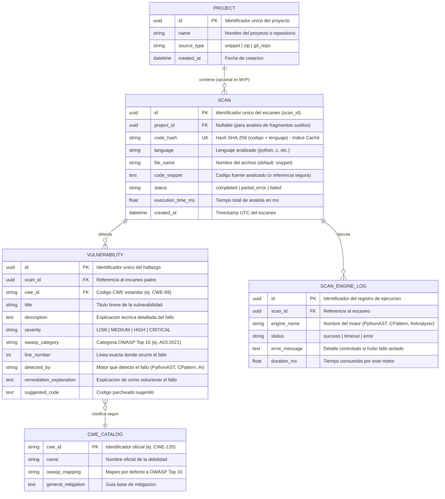

# 🗄️ Modelo Entidad-Relación (E-R) y Diseño de Base de Datos

**Proyecto:** Analizador SAST de Ciberseguridad con IA (TFG)  
**Versión:** 1.0  
**Tecnología ORM:** SQLAlchemy / SQLModel (Compatible con SQLite para desarrollo y PostgreSQL para producción)  

---

## 1. Propósito del Modelo de Datos

El diseño de la base de datos persigue tres objetivos clave definidos en los requisitos del sistema:
1. **Caché Inteligente (`RF-06`):** Evitar reprocesar fragmentos de código idénticos mediante indexación por huella criptográfica (`SHA-256`).
2. **Trazabilidad e Histórico (`RF-07`):** Mantener un registro auditable de todos los escaneos realizados, los motores ejecutados y las vulnerabilidades detectadas.
3. **Escalabilidad a Proyectos (`RF-09`):** Soportar tanto el análisis de fragmentos sueltos (MVP) como la futura agrupación de múltiples archivos dentro de un mismo proyecto o repositorio.

---

## 2. Diagrama Entidad-Relación (Mermaid ERD)

---

## 3. Diccionario de Entidades y Relaciones

### A. Entidad `SCAN` (Núcleo de Persistencia y Caché)
* **Clave Primaria (`id`):** UUIDv4 para evitar enumeración secuencial de escaneos en la API (`/api/v1/scans/{scan_id}`).
* **Índice Único (`code_hash`):** Almacena el resumen criptográfico `SHA-256(language + ":" + code)`. Permite realizar búsquedas en $O(1)$ para servir resultados desde caché sin invocar motores estáticos ni de IA.
* **Estado (`status`):** Refleja la tolerancia a fallos (`RNF-05`). Si el motor estático funcionó pero la IA falló, se marca como `partial_error` en lugar de perder el escaneo.

### B. Entidad `VULNERABILITY` (Hallazgos y Remediaciones)
* **Relación `1:N` con `SCAN`:** Un escaneo puede contener cero (código limpio) o múltiples vulnerabilidades.
* **Campos de Remediación:** Separa `remediation_explanation` (por qué falla y cómo arreglarlo) de `suggested_code` (el parche exacto), facilitando que el frontend muestre vistas comparativas (*diff*).

### C. Entidad `CWE_CATALOG` (Base de Conocimiento Normativa)
* **Propósito:** Normalizar las clasificaciones internacionales (**CWE** y **OWASP Top 10**) para evitar inconsistencias textuales entre distintos motores de análisis.

### D. Entidad `SCAN_ENGINE_LOG` (Auditoría de Motores)
* **Propósito:** Registrar el rendimiento y posibles fallos aislados de cada motor (`PythonASTEngine`, `CPatternEngine`, `AIEngine`) durante un escaneo, cumpliendo con los requisitos de observabilidad y optimización de costes.

---

## 4. Estrategia de Evolución (Migraciones)
* Se utilizará **Alembic** junto con SQLAlchemy/SQLModel para gestionar versiones del esquema de base de datos.
* **Entorno Local / MVP:** SQLite (`sast_tfg.db`) para cero configuración y portabilidad inmediata.
* **Entorno Producción / Escalado:** PostgreSQL mediante cambio de cadena de conexión en el archivo `.env`.