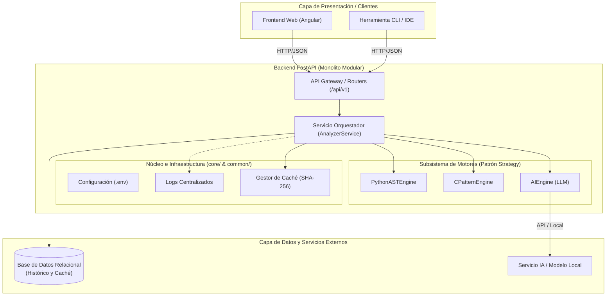
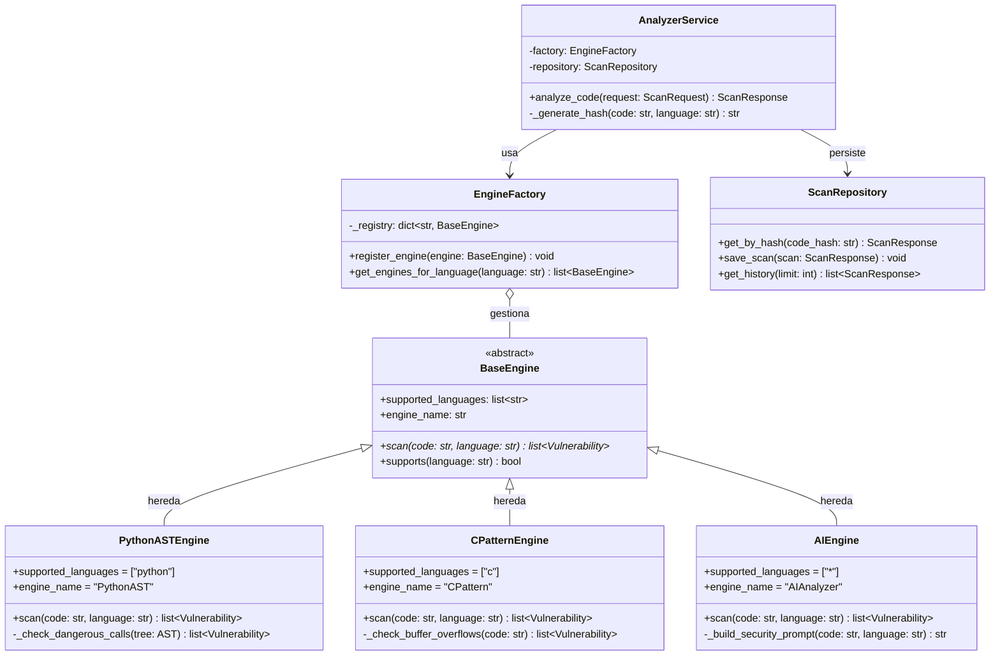
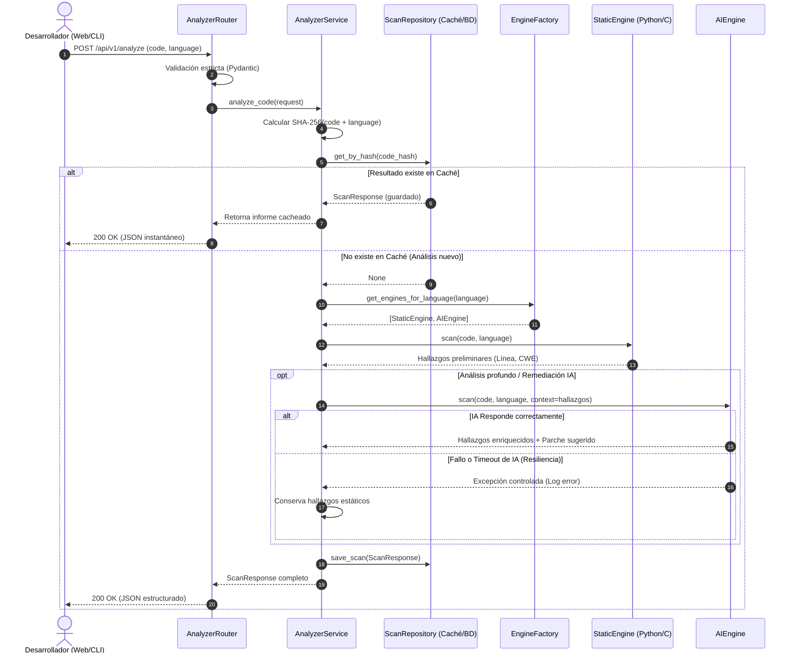

# Modelado Arquitectónico, Estructural y de Comportamiento

**Proyecto:** Analizador SAST de Ciberseguridad con IA (TFG)  
**Versión:** 1.0  
**Referencia:** Estándar UML 2.5 y Modelo C4  

---

## 1. Modelado Arquitectónico (Vista de Contenedores y Componentes - C4)

El modelado arquitectónico define la macroestructura del sistema, mostrando cómo interactúan los clientes externos con el núcleo modular de FastAPI, los motores de análisis y las capas de persistencia.

### Principios de esta Vista Arquitectónica:
* **Desacoplamiento de Clientes:** El backend expone una API REST pura, lo que permite añadir interfaces web (Angular) o de consola sin alterar la lógica del servidor.
* **Fronteras de Seguridad:** Toda entrada pasa por la capa de validación (`API`) antes de alcanzar el orquestador (`Orq`).

---

## 2. Modelado Estructural (Diagrama de Clases UML)

El modelado estructural representa la organización estática del código: clases, interfaces abstractas, atributos, métodos y relaciones de herencia o composición.

### Elementos Clave de la Estructura:
* **Herencia y Polimorfismo:** `PythonASTEngine`, `CPatternEngine` y `AIEngine` heredan de `BaseEngine`, garantizando que todos implementen el método `.scan()`.
* **Extensibilidad:** Añadir soporte para un nuevo lenguaje (ej. Java o JavaScript) implica únicamente crear una subclase de `BaseEngine` y registrarla en `EngineFactory`.

---

## 3. Modelado de Comportamiento (Diagrama de Secuencia UML)

El modelado de comportamiento describe la dinámica del sistema en tiempo de ejecución: cómo colaboran los objetos paso a paso desde que llega una petición de análisis hasta que se devuelve el informe con remediaciones.

### Garantías del Flujo de Comportamiento:
1. **Ahorro de Costes (`alt` Caché):** Si el código ya fue escaneado, se cortocircuita el flujo evitando ejecutar motores estáticos o consumir tokens de IA.
2. **Tolerancia a Fallos (`alt` Resiliencia IA):** Si el motor de IA falla o excede el tiempo de espera, el flujo no se interrumpe; el sistema registra el fallo y entrega al usuario los resultados deterministas obtenidos por el motor estático.
