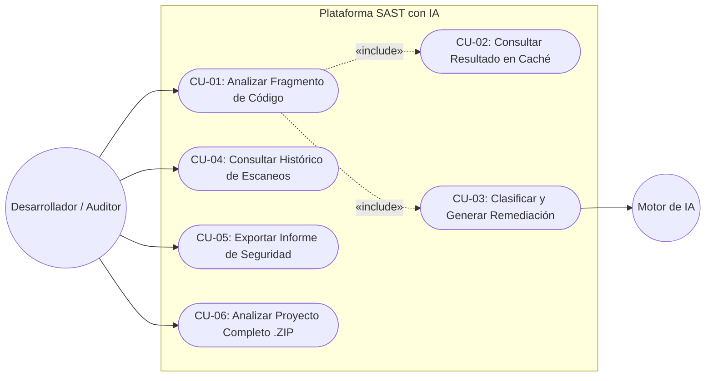

# Especificación de Casos de Uso (Use Cases)

**Proyecto:** Analizador SAST de Ciberseguridad con IA (TFG)  
**Versión:** 1.0  
**Referencia:** Basado en `Requisitos.md` y `DisenoSoftware.md`  

---

## 1. Identificación de Actores

* **Desarrollador / Auditor de Seguridad (Usuario Principal):** Persona o sistema cliente (Frontend Web, CLI, Extensión IDE) que envía fragmentos de código fuente o proyectos para detectar vulnerabilidades, consultar clasificaciones normativas y aplicar soluciones.
* **Sistema de Caché / Base de Datos (Actor Secundario):** Componente interno encargado de verificar huellas digitales (SHA-256) y persistir o recuperar historiales de escaneos.
* **Motor de Inteligencia Artificial (Actor Externo / Secundario):** Servicio o modelo LLM (local o remoto) invocado para realizar análisis semánticos profundos y generar explicaciones o parches de remediación.

---

## 2. Diagrama General de Casos de Uso (Mermaid)

---

## 3. Especificación Detallada de Casos de Uso

### CU-01: Analizar Fragmento de Código (Caso de Uso Principal - MVP)
* **Actor Principal:** Desarrollador / Auditor de Seguridad.
* **Descripción:** El usuario envía un bloque de código fuente (inicialmente en **Python** o **C**) a través de la API para detectar vulnerabilidades de seguridad.
* **Precondiciones:** 
  * El servidor FastAPI está operativo.
  * El payload cumple con el tamaño máximo permitido y formato JSON válido.
* **Flujo Principal (Éxito):**
  1. El actor envía una petición `POST /api/v1/analyze` con el código fuente y el lenguaje (`python` o `c`).
  2. El sistema valida los datos de entrada mediante esquemas Pydantic.
  3. El sistema calcula el hash `SHA-256` del código y ejecuta `CU-02` (Consultar Caché). Al no existir registro previo, continúa el flujo.
  4. El orquestador selecciona el motor estático (`ASTEngine`) correspondiente al lenguaje y ejecuta el análisis sintáctico/de patrones.
  5. El sistema ejecuta `CU-03` para enriquecer los hallazgos mediante el motor de IA y las reglas normativas.
  6. El sistema guarda el informe completo en la base de datos y registra la operación en el log.
  7. El sistema devuelve un código HTTP `200 OK` con el informe JSON estructurado.
* **Flujos Alternativos y de Excepción:**
  * **1a. Lenguaje no soportado por motor estático:** Si el lenguaje no tiene motor AST específico registrado, el sistema registra una advertencia y delega directamente en el motor de IA genérico.
  * **2a. Código vacío o exceso de tamaño (Protección DoS):** Pydantic rechaza la petición y devuelve `422 Unprocessable Entity` o `413 Payload Too Large`.
  * **5a. Fallo o Timeout del Motor de IA (Tolerancia a fallos):** El sistema captura la excepción, registra el error en `logger.py`, y devuelve los resultados obtenidos por el motor estático indicando que el análisis profundo por IA no estuvo disponible temporalmente.
* **Postcondiciones:** El escaneo queda almacenado en el histórico con un `scan_id` único.

---

### CU-02: Consultar Resultado en Caché
* **Actor Principal:** Sistema (Incluido en `CU-01`).
* **Descripción:** Verifica si un fragmento de código idéntico ya ha sido analizado previamente para ahorrar tiempo y recursos computacionales.
* **Flujo Principal:**
  1. El servicio genera el hash criptográfico `SHA-256` combinando el código fuente y el lenguaje.
  2. Consulta en la base de datos/caché si existe un escaneo previo asociado a ese hash.
  3. Si existe, recupera el informe JSON guardado y finaliza el análisis inmediatamente retornando el resultado al usuario.

---

### CU-03: Clasificar Vulnerabilidades y Generar Remediación
* **Actor Principal:** Sistema / Motor de IA (Incluido en `CU-01`).
* **Descripción:** Traduce los hallazgos técnicos en un informe accionable bajo estándares de ciberseguridad.
* **Flujo Principal:**
  1. Por cada vulnerabilidad detectada (ej. `eval()` en Python o `strcpy()` en C), el sistema determina su línea exacta.
  2. Asigna el nivel de criticidad (`LOW`, `MEDIUM`, `HIGH`, `CRITICAL`).
  3. Mapea el fallo a su categoría oficial **OWASP Top 10** y código **CWE** (ej. `CWE-120` para Buffer Overflow).
  4. Genera una explicación técnica clara y un fragmento de código parcheado (*suggested_code*) que resuelve el fallo manteniendo la funcionalidad original.

---

### CU-04: Consultar Histórico de Escaneos
* **Actor Principal:** Desarrollador / Auditor de Seguridad.
* **Descripción:** Permite recuperar análisis realizados en el pasado para auditoría o seguimiento de correcciones.
* **Flujo Principal:**
  1. El actor realiza una petición `GET /api/v1/scans` (listado paginado) o `GET /api/v1/scans/{scan_id}` (detalle específico).
  2. El repositorio consulta la base de datos.
  3. El sistema devuelve los metadatos y vulnerabilidades registradas en formato JSON.
* **Flujos Alternativos:**
  * **2a. Identificador no encontrado:** Si el `scan_id` no existe, devuelve HTTP `404 Not Found`.

---

### CU-05: Exportar Informe de Seguridad
* **Actor Principal:** Desarrollador / Auditor de Seguridad.
* **Descripción:** Permite descargar los resultados de un escaneo en un formato legible para documentación o entrega a equipos de desarrollo.
* **Flujo Principal:**
  1. El actor solicita la exportación indicando el `scan_id` y el formato deseado (`JSON` en MVP; extensible a `Markdown` / `PDF`).
  2. El módulo de reportes formatea los datos del escaneo.
  3. El sistema entrega el archivo descargable al cliente.

---

### CU-06: Analizar Proyecto Completo (.ZIP / Repositorio) — *Fase Escalable*
* **Actor Principal:** Desarrollador / Auditor de Seguridad.
* **Descripción:** Permite subir un proyecto empaquetado para auditar múltiples archivos de forma recursiva.
* **Flujo Principal:**
  1. El actor sube un archivo `.zip` mediante `POST /api/v1/analyze/project`.
  2. El sistema valida la integridad y tamaño del archivo (prevención de *Zip Bombs*) y lo extrae en un directorio temporal aislado.
  3. El orquestador filtra los archivos de código soportados, encola el análisis asíncrono y devuelve un `job_id` para seguimiento.
  4. Al finalizar, consolida todas las vulnerabilidades por archivo en un único reporte global y elimina los archivos temporales.
